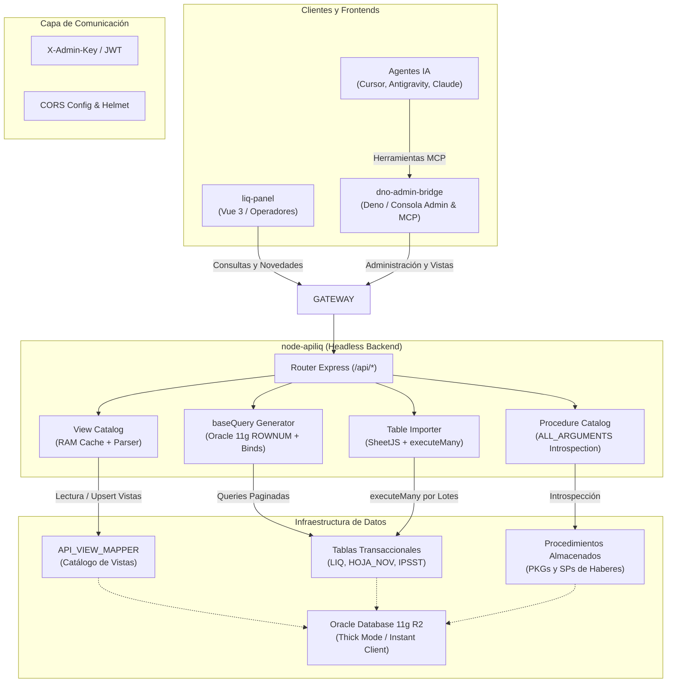

# Arquitectura Actual, Resolución de Deuda Técnica y Proyección de la API (`node-apiliq`)

> **Fecha:** 16 de Octubre de 2026  
> **Servicio:** API de Liquidación de Sueldos Municipal (`node-apiliq` / `api_liquid`)  
> **Base de Datos Core:** Oracle Database 11g Release 2 (11.2.x) en Modo Thick  
> **Frontend de Administración:** `dno-admin-bridge` (Independiente / Edge / Deno)  
> **Frontend de Operaciones:** `liq-panel` (Vue 3 / Vite)  

---

## 📑 Índice de Contenidos

1. [Resumen Ejecutivo y Estado del Arte](#1-resumen-ejecutivo-y-estado-del-arte)
2. [Características Actuales de la API](#2-caracter%C3%ADsticas-actuales-de-la-api)
3. [Qué se Resolvió Respecto al Código Principal (Matriz de Mejoras)](#3-qu%C3%A9-se-resolvi%C3%B3-respecto-al-c%C3%B3digo-principal-matriz-de-mejoras)
4. [Desacoplamiento: Prescindir de `index.html` (Transición a Headless API)](#4-desacoplamiento-prescindir-de-indexhtml-transici%C3%B3n-a-headless-api)
5. [Proyección y Hoja de Ruta (Roadmap)](#5-proyecci%C3%B3n-y-hoja-de-ruta-roadmap)
6. [Diagrama de Arquitectura Global](#6-diagrama-de-arquitectura-global)

---

## 1. Resumen Ejecutivo y Estado del Arte

La API `node-apiliq` evolucionó desde un despachador monolítico con mapeos estáticos en archivos de disco hacia una **plataforma desacoplada, resiliente y de alto rendimiento**, diseñada específicamente para intermediar entre frontends modernos (Vue 3, Deno, Angular) y motores heredados **Oracle Database 11g R2**.

Con la creación y consolidación del nuevo frontend independiente y puente de gestión (`dno-admin-bridge`), la API en Node.js puede consolidarse definitivamente como un **servicio 100% Headless**, eliminando la necesidad de servir interfaces web estáticas y concentrando sus recursos en seguridad, concurrencia y acceso a datos transaccionales.

---

## 2. Características Actuales de la API

### 2.1. Motor de Vistas Dinámicas y Proyección de Columnas (`/api/view/*`)
* **Proyección Dinámica de Campos (`?fields=...`):** Permite solicitar únicamente las columnas requeridas (ej: `?fields=PersonaId,ApeNom,Neto`), reduciendo drásticamente el consumo de ancho de banda y latencia sobre conexiones VPN municipales.
* **Caché Jerárquica Multinivel (RAM $\to$ Oracle $\to$ Fallback local):**
  1. **Nivel 1 (RAM):** Acceso inmediato en 0 ms.
  2. **Nivel 2 (Oracle `API_VIEW_MAPPER`):** Persistencia dinámica configurable en caliente mediante `SP_UPSERT_VISTA`.
  3. **Nivel 3 (Disco `mapperViews.js` / `mapperViews.local.json`):** Resiliencia absoluta; si la base de datos se reinicia o está inaccesible, la API no se detiene y resuelve con su configuración de respaldo.
* **Paginación Nativa Oracle 11g:** Algoritmo estricto basado en subconsulta de doble capa con `ROWNUM` (`rnum > :minRow AND ROWNUM <= :maxRow`), preservando el ordenamiento exacto y evitando la sintaxis incompatible de Oracle 12c+ (`OFFSET ... ROWS`).
* **Protección contra Inyecciones SQL:** Reemplazo total de interpolación de strings por parámetros bind posicionales y nombrados (`:b_0`, `:campo`).

### 2.2. Introspección y Despacho Dinámico de Procedimientos y Funciones (`/api/sp/*`, `/api/fn/*`)
* **Introspección en Caliente de `ALL_ARGUMENTS`:** La API detecta en tiempo real la firma oficial en Oracle (parámetros `IN`, `OUT`, `IN/OUT`, tipos de datos).
* **Supresión Automática de Parámetros Inexistentes:** Previene errores fatales de Oracle (`PLS-00306`) omitiendo binds sobrantes como `out_param` cuando el procedimiento PL/SQL no tiene parámetros de salida.
* **Coerción Automática de Tipos:** Conversión inteligente de strings a objetos `Date` nativos y `Number` para binds de Oracle, resolviendo discrepancias de formatos entre clientes HTTP y la base de datos.
* **Compatibilidad de Nombres:** Resolución de alias normalizados (`<paquete>_<procedimiento>` y nombres legacy) sin sensibilidad a mayúsculas/minúsculas.

### 2.3. Módulo de Importación Masiva de Datos (`/api/import/*`)
* **Soporte Multiformato:** Procesamiento binario en memoria de `.xlsx`, `.xls`, `.csv`, `.tsv` y `.txt` mediante `xlsx` (SheetJS).
* **Inspección de Esquema en Vivo:** Detección de tipos de columnas en Oracle (`all_tab_columns`) y tipado exacto de `bindDefs` (`STRING`, `NUMBER`, `DATE`).
* **Inserción por Lotes de Alto Desempeño:** Uso de `connection.executeMany()` en bloques configurables (por defecto 2000 filas por lote), con soporte para transacciones atómicas (`commit`/`rollback` total).
* **Limpieza Previa Opcional:** Soporte para vaciado de tablas con fallback automático `TRUNCATE TABLE` $\to$ `DELETE FROM`.

### 2.4. Seguridad Institucional y Robustez Operativa
* **Autenticación con Tiempo Constante (`adminAuth.js`):** Uso de `crypto.timingSafeEqual` para validar cabeceras `X-Admin-Key`, anulando ataques de temporización (*timing attacks*).
* **Saneamiento Selectivo de Errores:** En producción, los errores 500 ocultan consultas SQL internas, binds y nombres de paquetes a clientes externos; sólo se exponen ante solicitudes autenticadas con la clave de administración.
* **Protección HTTP:** Cabeceras de seguridad activas mediante `helmet`, límites en `body-parser` (50MB para cargas de planillas) y control granular de CORS.
* **Suite de Pruebas Unitarias Integrada:** 91 pruebas automatizadas con el ejecutor nativo de Node.js (`node --test`), ejecutables en < 1.5 segundos sin depender de librerías externas pesadas.

---

## 3. Qué se Resolvió Respecto al Código Principal (Matriz de Mejoras)

| Área / Problema Original | Estado en Código Legacy | Solución Implementada en Versión Actual | Impacto Operativo |
| :--- | :--- | :--- | :--- |
| **Mapeo de Vistas** | Mappers estáticos en archivos JS (`config/mapperViews.js`). Cualquier cambio requería modificar código, hacer commit y reiniciar el servidor. | Catálogo dinámico en Oracle (`API_VIEW_MAPPER`), caché en memoria y endpoints de actualización en caliente (`/api/view/save`, `/api/view/refresh`). | Cambios en consultas SQL en tiempo real sin downtime ni reinicio de servicios. |
| **Paginación en Oracle 11g** | Riesgo de usar sintaxis moderna incompatible (12c+) o paginación ineficiente en Node trayendo miles de registros a memoria. | Patrón estricto de triple subconsulta con `ROWNUM` implementado en `db_apis/baseQuery.js`. | Compatibilidad 100% con Oracle 11.2.0.4. Paginación eficiente ejecutada en el motor de base de datos. |
| **Selección de Columnas** | Siempre se ejecutaba `SELECT *` o la lista fija completa de columnas, saturando redes lentas. | Proyección dinámica selectiva con `?fields=ColA,ColB`, validando nombres con regex estricta. | Reducción de hasta un 80% en el tamaño de las cargas útiles transferidas por la VPN. |
| **Llamadas a Stored Procedures** | Generación manual y rígida de bloques PL/SQL. Nombres de parámetros quemados (`vIDREP`, etc.). Error frecuente `PLS-00306`. | Introspección automática de argumentos desde el diccionario de datos de Oracle. Enlace flexible de parámetros (case-insensitive) y supresión de `out_param` espurios. | Ejecución transparente de cualquier procedimiento almacenado sin modificar el backend. |
| **Manejo de Fechas y Números** | Strings de fecha ISO o formatos locales provocaban error `ORA-01861: literal does not match format string`. | Coerción automática en `spapi.getSQLbinds()` a `Date` nativo y números casteados antes de pasar a `oracledb`. | Eliminación de fallos de inserción y consulta en procedimientos con parámetros de fecha. |
| **Carga de Archivos a Tablas** | Solo existía un script específico para archivos de novedades IPSST (`tmp/<uuid>.json`). | Módulo genérico de importación (`/api/import/*`) con preview, mapeo de columnas, validación de tipos y `executeMany`. | Capacidad de poblar cualquier tabla municipal desde Excel/CSV en segundos. |
| **Seguridad de Endpoints Críticos** | Rutas administrativas y `/adduser` expuestas sin validación formal o con comparación insegura de strings. | Middleware `adminAuth` con `timingSafeEqual`, validación de cabecera `X-Admin-Key` y endpoints protegidos. | Mitigación de accesos no autorizados y ataques de fuerza bruta basados en temporización. |
| **Carga del Driver Oracle** | Configuraciones manuales confusas entre Thick y Thin mode que rompían en macOS ARM / Linux. | Detección automática y robusta de Instant Client en `services/database.js` y script de diagnóstico `scripts/test-oracle-client.js`. | Despliegue predecible en servidores Linux y máquinas de desarrollo locales. |

---

## 4. Desacoplamiento: Prescindir de `index.html` (Transición a Headless API)

### 4.1. Justificación Técnica
Inicialmente, el archivo `services/public/admin/index.html` fue incorporado como un Developer Studio autónomo (Single Page Application en Vanilla JS sin CDNs) para permitir administrar vistas, probar procedimientos y subir archivos en redes municipales aisladas.

Sin embargo, **hoy ya contamos con:**
1. **`dno-admin-bridge`**: Un centro de control y administración moderno, desacoplado, desplegado en edge (Deno Deploy) o local, con selector de backends (Trancas, Concepción, etc.), autenticación independiente, inspector SQL y capacidades de IA (MCP).
2. **`liq-panel`**: Frontend institucional en Vue 3 para los usuarios operativos de liquidación de sueldos.

### 4.2. Beneficios de Prescindir del `index.html` en `node-apiliq`
* **Reducción de Superficie de Ataque:** La API pasa a ser una **API REST pura (Headless)**. No sirve contenido HTML, CSS ni archivos estáticos al exterior, anulando riesgos de XSS o fugas en el servidor estático de Express.
* **Menor Consumo de Memoria y E/S:** Se desactiva el middleware de archivos estáticos `express.static()` para la interfaz web.
* **Cero Duplicación de Mantenimiento:** Toda mejora de UI (diseño institucional, accesibilidad, temas por municipio) se concentra en `dno-admin-bridge` sin tener que sincronizar código HTML/CSS en dos repositorios.
* **Claridad Arquitectónica:** Separación limpia de responsabilidades:
  - `node-apiliq`: Procesamiento de datos de alta velocidad y conexión a Oracle.
  - `dno-admin-bridge`: Orquestación, UI administrativa e integración con agentes de IA.

### 4.3. Plan de Retiro / Desactivación
Podemos implementar la transición de dos formas:
1. **Inmediata sin romper instalaciones existentes:** Establecer en la configuración o `.env` la variable `ENABLE_ADMIN_STUDIO=false`. `services/web_server.js` ya contempla esta condición y no levantará la ruta `/admin`.
2. **Desacoplamiento definitivo:**
   - Eliminar el directorio `services/public/admin/`.
   - Remover las líneas de montaje de `/admin` en `services/web_server.js` y `app.use(express.static(...))` en `services/router.js`.
   - Dejar una respuesta JSON informativa en la raíz:
     ```json
     {
       "service": "node-apiliq",
       "status": "online",
       "version": "1.0.0",
       "docs": "Usa dno-admin-bridge para acceder a la consola administrativa"
     }
     ```

---

## 5. Proyección y Hoja de Ruta (Roadmap)

### Fase 1: Arquitectura Multi-Backend & Edge Gateway (Actual / Inmediata)
* Consolidar `dno-admin-bridge` como el punto de entrada unificado para conmutar dinámicamente entre municipios (Trancas, Concepción, Burruyacú, Tafí Viejo) mediante un solo selector visual y con tokens administrativos independientes por nodo.
* Centralizar la gestión de catálogos y sincronización de vistas (`seed-from-file`, `import-json`) desde el bridge.

### Fase 2: Ecosistema Model Context Protocol (MCP) para Inteligencia Artificial
* Proveer a agentes IA (Claude, Antigravity, Cursor) herramientas MCP estandarizadas para:
  - Consultar esquemas de tablas y vistas en lenguaje natural.
  - Ejecutar consultas analíticas controladas (ej: *"¿Cuántos legajos cobraron adicional por antigüedad este mes?"*).
  - Diagnosticar inconsistencias en novedades de sueldos o archivos de aportes IPSST.

### Fase 3: Capa de Rendimiento y Caché de Resultados
* Incorporar una capa de almacenamiento en caché con tiempo de vida (TTL) para consultas maestras altamente repetitivas (escalafones, categorías, conceptos de haberes fijos, reparticiones).
* Reducción de la carga de lectura en servidores de producción Oracle 11g mediante cacheo selectivo en RAM.

### Fase 4: Telemetría y Registro Estructurado
* Migración del registro básico en `access.log` a registros estructurados en JSON con correlación de peticiones (`X-Request-Id`).
* Métricas en tiempo real de tiempos de ejecución por procedimiento almacenado y vista SQL para identificar cuellos de botella en Oracle.

---

## 6. Diagrama de Arquitectura Global



---
> *Documento generado para el equipo de desarrollo y administración de liquidación de sueldos.*
