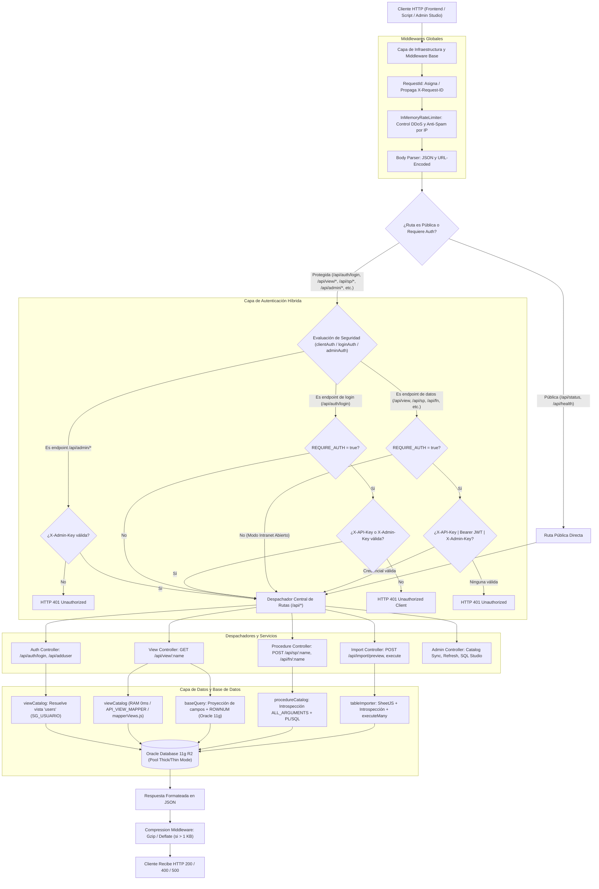
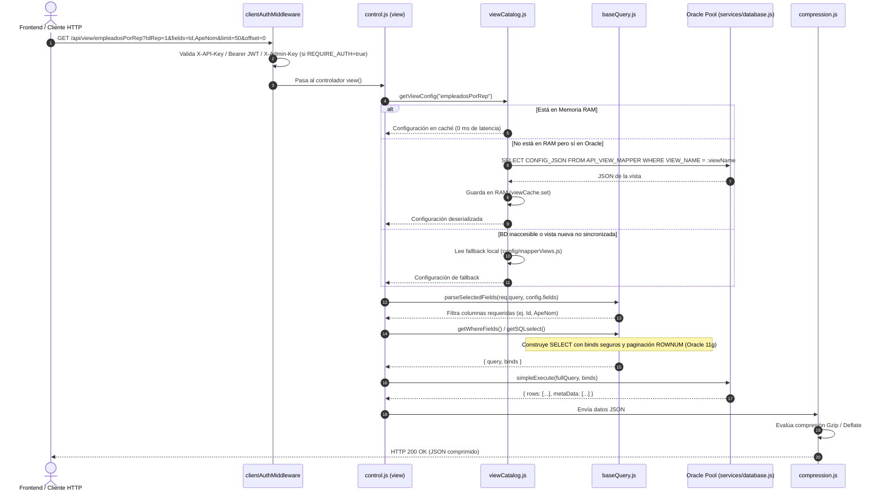
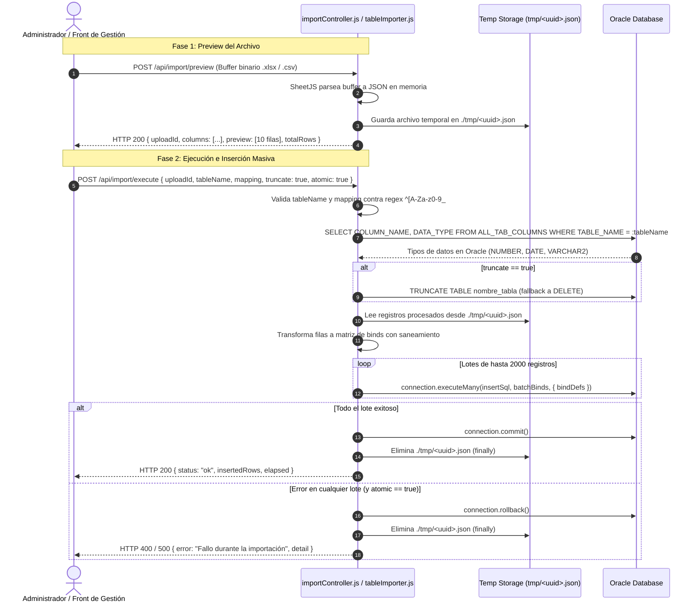

# 📊 Diagramas de Flujo y Secuencia — API `node-apiliq`

Este documento detalla la arquitectura operativa, el flujo general de las peticiones HTTP y los diagramas de secuencia de los flujos críticos de la API de Sueldos y Recursos Humanos (**Oracle 11g R2 / Express 4**).

---

## 🧭 1. Diagrama de Flujo General de la API

Muestra el ciclo de vida de una petición HTTP desde su ingreso hasta la salida comprimida, atravesando capas de seguridad, enrutamiento, caché en RAM y acceso a Oracle.



---

## 🔐 2. Diagrama de Secuencia: Autenticación de Usuarios (`POST /api/auth/login`)

Flujo de inicio de sesión que resuelve dinámicamente la vista de usuarios (`SG_USUARIO`), valida estado activo, verifica el hash de contraseña (Bcrypt con tolerancia legacy) y emite un JWT firmado con **HS256**.

```mermaid
sequenceDiagram
    autonumber
    actor Cliente as Frontend (Vue 3 / Angular / Script)
    participant Router as router.js (loginAuthMiddleware)
    participant AuthCtrl as controlUsers.js (login)
    participant VC as viewCatalog.js
    participant DB as Oracle (services/database.js)
    participant Crypto as Node.js Crypto (HS256)

    Cliente->>Router: POST /api/auth/login { usr, pws } (Cabecera: X-API-Key: <API_CLIENT_KEY>)
    
    alt REQUIRE_AUTH=true y falta X-API-Key o X-Admin-Key
        Router-->>Cliente: HTTP 401 Unauthorized Client (Rebote previo sin tocar Oracle)
    else Clave de cliente válida o REQUIRE_AUTH=false
        Router->>AuthCtrl: login(req, res, next)
    end
    
    AuthCtrl->>VC: getViewConfig("users")
    Note over VC: Busca en RAM; si no está, lee API_VIEW_MAPPER o mapperViews.js
    VC-->>AuthCtrl: Retorna { fields, fromClause: ["FROM SG_USUARIO"] }

    AuthCtrl->>DB: simpleExecute("SELECT IDUS, DNI, USUARIO, CLAVE, MAIL, IDESTADOUS... FROM SG_USUARIO WHERE LOWER(USUARIO) = LOWER(:usr)", { usr })
    DB-->>AuthCtrl: Retorna filas de usuario
    
    alt Usuario no encontrado
        AuthCtrl-->>Cliente: HTTP 401 Credenciales inválidas
    else Usuario inactivo (IDESTADOUS = 0, 2 o 'I')
        AuthCtrl-->>Cliente: HTTP 403 Usuario inactivo. Contacta al administrador
    else Usuario activo
        Note over AuthCtrl: Compara contraseña (Bcrypt, plano o MD5)
        alt Contraseña incorrecta
            AuthCtrl-->>Cliente: HTTP 401 Credenciales inválidas
        else Contraseña válida
            AuthCtrl->>Crypto: createJwtHS256({ sub, userId, dni, email, role, app }, JWT_SECRET, 28800s)
            Crypto-->>AuthCtrl: Retorna token JWT (header.payload.signature)
            AuthCtrl-->>Cliente: HTTP 200 { status: "ok", token, expiresInSeconds: 28800, user: { ... } }
        end
    end
```

---

## 📑 3. Diagrama de Secuencia: Consulta de Vistas Dinámicas (`GET /api/view/:name`)

Flujo de consulta de datos que implementa caché multinivel (RAM 0 ms, catálogo en BD y fallback local), proyección de columnas bajo demanda (`fields=...`) y paginación compatible con **Oracle 11g R2** mediante subconsultas `ROWNUM`.



---

## ⚡ 4. Diagrama de Secuencia: Ejecución de Stored Procedures (`POST /api/sp/:name`)

Flujo de ejecución de procedimientos almacenados con introspección en tiempo real (`ALL_ARGUMENTS`), vinculación de parámetros de entrada/salida (incluyendo cursores `SYS_REFCURSOR`) y clasificación determinística de errores PL/SQL (400 vs 500).

```mermaid
sequenceDiagram
    autonumber
    actor Cliente as Frontend / Cliente HTTP
    participant SpCtrl as control.js (storeProcedure)
    participant PC as procedureCatalog.js
    participant DB as Oracle (services/database.js)

    Cliente->>SpCtrl: POST /api/sp/hojaIns { vIDREP: 1, vPERIODO: "01/09/2026", ... }
    SpCtrl->>PC: getSpConfig("hojaIns")
    
    alt Configuración en caché RAM
        PC-->>SpCtrl: Metadatos del SP (in_param, out_param, tipos)
    else Introspección en vivo
        PC->>DB: Introspecciona ALL_ARGUMENTS para el paquete/procedimiento
        DB-->>PC: Argumentos reales de Oracle
        PC->>PC: Guarda en RAM
        PC-->>SpCtrl: Metadatos calculados
    end

    SpCtrl->>SpCtrl: Mapea binds y normaliza fecha período (día 01)
    SpCtrl->>SpCtrl: Construye bloque anónimo PL/SQL: BEGIN MOD_NOV.SPI_HOJA_NOV(...); END;
    
    SpCtrl->>DB: execute(plsqlBlock, binds, { autoCommit: true })
    DB-->>SpCtrl: Retorna outBinds { ValorSalida, ValorError, vErrorMsg, Cursor }

    alt Error de Base de Datos (ValorError < 0)
        SpCtrl-->>Cliente: HTTP 500 Internal Server Error { status: 500, error: "ORA-...", ... }
    else Error de Negocio / Validación (ValorError > 0 o vErrorMsg presente)
        SpCtrl-->>Cliente: HTTP 400 Bad Request { status: 400, error: vErrorMsg, ... }
    else Ejecución Exitosa
        SpCtrl-->>Cliente: HTTP 200 OK { status: 200, out: { ... }, elapsed: "12ms" }
    end
```

---

## 📥 5. Diagrama de Secuencia: Carga Masiva de Archivos a Tablas (`POST /api/import/*`)

Flujo de importación en 2 fases (**Preview** y **Execute**) con parseo de hojas de cálculo (Excel `.xlsx`/`.xls`, `.csv`), tipado automático contra el esquema de Oracle y procesamiento por lotes atómico (`executeMany`).



---

## 🛡️ 6. Resumen de Invariantes Reflejados en los Diagramas

1. **Paginación Oracle 11g R2:** Subconsultas anidadas con `ROWNUM` (sin `FETCH NEXT`).
2. **Cero Concatenación SQL:** Todo parámetro de filtro o procedimiento viaja a través de binds tipados (`:usr`, `:b_0`, `:maxRow`).
3. **Normalización de Fechas:** Todo período de liquidación (`PERIODO`) se normaliza al **día 01 del mes** en hora local (`01/MM/YYYY`).
4. **Caché en Memoria RAM (0 ms):** `viewCatalog` y `procedureCatalog` resuelven en microsegundos sin sobrecargar el catálogo del diccionario de datos de Oracle.
5. **Autenticación Híbrida Desacoplada:** Acceso flexible para scripts internos (`X-API-Key`), usuarios finales autenticados (`Bearer JWT`) y tareas administrativas (`X-Admin-Key`).
