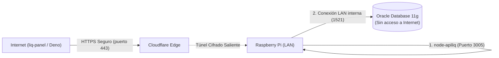

# 🍓 Instructivo de Despliegue: `node-apiliq` en Raspberry Pi con Cloudflare Tunnel

> **Proyecto:** `node-apiliq` (API Liquidación de Sueldos)  
> **Objetivo:** Exponer la API a Internet de forma segura y cifrada por HTTPS sin abrir puertos en el router municipal y manteniendo la base de datos Oracle 11g aislada en la red local.  
> **Arquitectura:** DMZ / Bastion Appliance (Raspberry Pi 4 / 5 con Cloudflare Tunnel).  

---

## 🏗️ Diagrama de Topología



---

## 📋 Requisitos Previos

1. **Hardware:** Raspberry Pi 4 (2 GB, 4 GB u 8 GB de RAM) o Raspberry Pi 5.
2. **Sistema Operativo:** **Raspberry Pi OS de 64 bits** (*Debian aarch64*) o **Ubuntu Server 22.04 / 24.04 ARM64**.
   * *Nota crítica:* Debe ser de **64 bits** para soportar las librerías nativas de Oracle Instant Client.
3. Conexión por cable de red o WiFi a la misma LAN donde se encuentra el servidor Oracle 11g.
4. Una cuenta gratuita en [Cloudflare](https://dash.cloudflare.com).

---

## 🚀 Método A: La Raspberry Pi corre TODO (`node-apiliq` + Túnel)
*(Convierte la Raspberry en un servidor autónomo de bajo consumo que atiende la API 24/7).*

### Paso 1: Actualizar el sistema e instalar dependencias básicas
Conéctate por SSH o abre la terminal en la Raspberry Pi:
```bash
sudo apt update && sudo apt upgrade -y
sudo apt install -y curl wget git unzip libaio1
```

---

### Paso 2: Instalar Node.js 20 LTS
```bash
# Repositorio oficial de NodeSource para ARM64
curl -fsSL https://deb.nodesource.com/setup_20.x | sudo -E bash -
sudo apt install -y nodejs

# Verificar versiones
node -v   # Debe decir v20.x.x
npm -v
```

---

### Paso 3: Instalar Oracle Instant Client para ARM64 (Linux aarch64)
Oracle dispone de binarios oficiales para procesadores ARM de 64 bits:

```bash
# 1. Crear directorio para Oracle
sudo mkdir -p /opt/oracle
cd /opt/oracle

# 2. Descargar Instant Client Basic 19c para Linux ARM64
sudo wget https://download.oracle.com/otn_software/linux/instantclient/1919000/instantclient-basic-linux.arm64-19.19.0.0.0dbru.zip

# 3. Descomprimir y configurar permisos
sudo unzip instantclient-basic-linux.arm64-19.19.0.0.0dbru.zip
sudo rm instantclient-basic-linux.arm64-19.19.0.0.0dbru.zip

# 4. Registrar las librerías en el sistema operativo
echo "/opt/oracle/instantclient_19_19" | sudo tee /etc/ld.so.conf.d/oracle-instantclient.conf
sudo ldconfig
```

---

### Paso 4: Clonar e Instalar `node-apiliq`

```bash
# Clonar en la carpeta home
cd ~
git clone https://github.com/jferreyradev/node-apiliq.git
cd node-apiliq

# Instalar dependencias
npm install

# Crear archivo de configuración .env
cp .env.example .env 2>/dev/null || nano .env
```

Configura tu `.env` apuntando a la **IP privada del servidor Oracle en la red local**:
```env
USERDB="US_SUELDO"
PASSWORD="TuPassword"
# Coloca la IP privada de Oracle en la red local (ej: 192.168.1.50)
CONNECTIONSTRING="192.168.1.50:1521/desa"

PORT=3005
ADMIN_ACCESS_KEY="admin_liq_2026"
ENABLE_ADMIN_STUDIO=false
```

Prueba que todo funcione ejecutando la suite de tests:
```bash
npm test
# Debe arrojar 107 tests en verde
```

---

### Paso 5: Dejar la API corriendo 24/7 con `pm2`
Para que la API inicie automáticamente tras reinicios o cortes de energía:

```bash
sudo npm install -g pm2
pm2 start index.js --name "api-sueldos"
pm2 save
pm2 startup
# Ejecuta el comando que pm2 imprima en pantalla
```

---

### Paso 6: Instalar y Configurar Cloudflare Tunnel (`cloudflared`)

#### 6.1. Instalar `cloudflared` en la Raspberry Pi (ARM64)
```bash
curl -L --output cloudflared.deb https://github.com/cloudflare/cloudflared/releases/latest/download/cloudflared-linux-arm64.deb
sudo dpkg -i cloudflared.deb
rm cloudflared.deb
```

#### 6.2. Autenticar con tu cuenta de Cloudflare
```bash
cloudflared tunnel login
```
*Aparecerá un enlace en la terminal. Ábrelo en tu navegador y selecciona el dominio que tienes en Cloudflare.*

#### 6.3. Crear el túnel
```bash
cloudflared tunnel create api-sueldos
# Anota el UUID que te devolverá (ej: 12345678-abcd-1234-ef01-123456789abc)
```

#### 6.4. Configurar el túnel
```bash
mkdir -p ~/.cloudflared
nano ~/.cloudflared/config.yml
```
Pega el siguiente contenido (reemplaza con tu UUID y dominio):
```yaml
tunnel: TU_TUNNEL_UUID
credentials-file: /home/pi/.cloudflared/TU_TUNNEL_UUID.json

ingress:
  - hostname: api.tumunicipio.gob.ar
    service: http://localhost:3005
  - service: http_status:404
```

Asocia el subdominio DNS:
```bash
cloudflared tunnel route dns api-sueldos api.tumunicipio.gob.ar
```

#### 6.5. Instalar como servicio permanente de sistema
```bash
sudo cloudflared service install
sudo systemctl enable --now cloudflared
```

---

## ⚡ Método B: La Raspberry Pi como "Puente / Gateway" Rápido (5 Minutos)
*(Usa este método si la API ya corre en una PC o servidor existente en la LAN en `http://192.168.1.100:3005`).*

1. En la Raspberry Pi solo instalas `cloudflared`:
   ```bash
   curl -L --output cloudflared.deb https://github.com/cloudflare/cloudflared/releases/latest/download/cloudflared-linux-arm64.deb
   sudo dpkg -i cloudflared.deb
   ```
2. Inicias un túnel rápido apuntando a la IP de la otra máquina en la red local:
   ```bash
   cloudflared tunnel --url http://192.168.1.100:3005
   ```
3. Cloudflare te asignará una URL pública HTTPS inmediata (ej. `https://random-word.trycloudflare.com`).

---

## ✅ Verificación Final

Desde cualquier red externa (ej. red celular 4G/5G):
```bash
curl -I https://api.tumunicipio.gob.ar/api/view/list
```
Respuesta esperada:
```http
HTTP/2 200
content-type: application/json; charset=utf-8
x-request-id: 84a0d92e-b6fe-4f91-...
vary: Accept-Encoding
```
