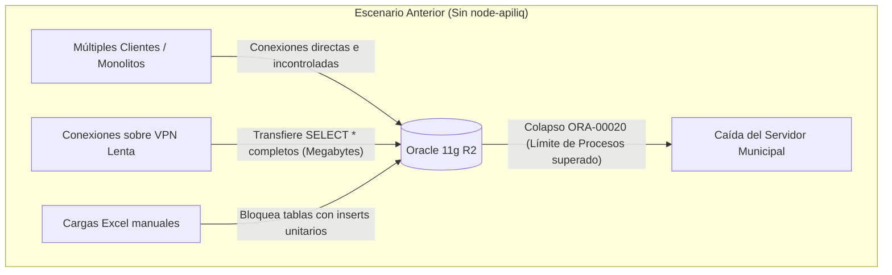
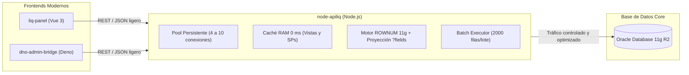

# 🏛️ Documento Técnico de Fundamentación y Diseño Arquitectónico
## Sistema de Intermediación de Alta Velocidad para Liquidación de Sueldos (`node-apiliq`)

> **Documento para Presentación y Defensa Técnica ante Comités y Stakeholders**  
> **Proyecto:** `node-apiliq` (API Liquidación de Sueldos)  
> **Área:** Modernización de Sistemas / Infraestructura y Desarrollo  
> **Fecha de Actualización:** Octubre de 2026  
> **Estado:** En Producción / Homologado  

---

## 📑 Tabla de Contenidos

1. [Resumen Ejecutivo](#1-resumen-ejecutivo)
2. [El Problema de Origen: Diagnóstico del Escenario Heredado](#2-el-problema-de-origen-diagnóstico-del-escenario-heredado)
   - 2.1. Saturación de recursos y conexiones en Oracle 11g
   - 2.2. Colapso de ancho de banda en enlaces VPN municipales
   - 2.3. Rígida dependencia de esquemas y riesgo de inyección SQL
   - 2.4. Ineficiencia en la carga masiva de planillas
3. [Objetivo del Proyecto: ¿Por qué se construyó `node-apiliq`?](#3-objetivo-del-proyecto-por-qué-se-construyó-node-apiliq)
4. [Fundamentación Tecnológica: ¿Por qué Node.js y no PHP u otras alternativas?](#4-fundamentación-tecnológica-por-qué-nodejs-y-no-php-u-otras-alternativas)
   - 4.1. Conexiones persistentes y pooling nativo vs. modelo Shared-Nothing
   - 4.2. Modelo de concurrencia asíncrono y latencia
   - 4.3. Caché de catálogo dinámico en RAM a 0 ms
   - 4.4. Procesamiento masivo de lotes (`executeMany`)
   - 4.5. Homogeneidad del stack tecnológico
5. [Pilares de la Solución Arquitectónica](#5-pilares-de-la-solución-arquitectónica)
   - 5.1. Patrón Headless API desacoplado
   - 5.2. Motor de vistas dinámicas con proyección selectiva (`?fields=...`)
   - 5.3. Paginación segura garantizada para Oracle 11g R2 (`ROWNUM`)
   - 5.4. Introspección y ejecución automática de PL/SQL en tiempo real
   - 5.5. Regla de dominio estricta para períodos (Día `01`)
   - 5.6. Motor de importación masiva en memoria
6. [Seguridad y Resiliencia Operativa](#6-seguridad-y-resiliencia-operativa)
7. [Métricas de Impacto y Beneficios Cuantificables](#7-métricas-de-impacto-y-beneficios-cuantificables)
8. [Conclusión y Recomendación Final](#8-conclusión-y-recomendación-final)

---

## 1. Resumen Ejecutivo

El presente documento expone las justificaciones técnicas, operativas y de infraestructura que motivaron la creación y consolidación de la API **`node-apiliq`**. 

El sistema de Liquidación de Sueldos municipal depende de una base de datos central **Oracle Database 11g Release 2 (11.2.0.4)**. Este motor, crítico para el funcionamiento de la administración pública, coexistía históricamente con interfaces web monolíticas y accesos poco controlados que causaban saturación de procesos, caídas por consumo de enlaces WAN/VPN y vulnerabilidades de seguridad.

Para resolver de raíz esta problemática sin incurrir en los costos y riesgos exorbitantes de migrar la base de datos core, se diseñó **`node-apiliq`**: una capa intermedia de alta velocidad (**Headless API Gateway**) desarrollada en **Node.js**. Esta solución abstrae toda la complejidad de Oracle 11g, optimiza las conexiones de red, protege la base de datos mediante un pool persistente controlado y expone servicios REST seguros, ultrarrápidos y estándar para los nuevos frontends (`liq-panel` en Vue 3 y `dno-admin-bridge` en Deno).

---

## 2. El Problema de Origen: Diagnóstico del Escenario Heredado

Antes de la existencia de este proyecto, la interacción con la base de datos de liquidación de sueldos presentaba cuatro problemas estructurales que amenazaban la continuidad operativa:



### 2.1. Saturación de recursos y conexiones en Oracle 11g
En entornos municipales, la base de datos Oracle 11g suele estar compartida entre diversos módulos (Sueldos, Rentas, Catastro, Mesa de Entradas). El parámetro `PROCESSES` del motor define cuántas conexiones dedicadas simultáneas puede aceptar. 
Cuando múltiples clientes o tecnologías basadas en modelos efímeros (como PHP tradicional) abrían una conexión dedicada por cada petición o usuario, la base de datos agotaba su cupo, desencadenando el error crítico **`ORA-00020: maximum number of processes exceeded`**, lo que provocaba la caída total de los servicios municipales.

### 2.2. Colapso de ancho de banda en enlaces VPN municipales
Las dependencias municipales y los operadores remotos operan a menudo sobre conexiones de red lentas o túneles VPN de bajo ancho de banda. Los sistemas anteriores ejecutaban consultas del tipo `SELECT *`, trayendo decenas de columnas innecesarias para mostrar una simple lista o grilla en pantalla. Esto saturaba la red, generaba esperas de hasta 15 o 30 segundos por pantalla y degradaba la experiencia de los liquidadores.

### 2.3. Rígida dependencia de esquemas y riesgo de inyección SQL
Cualquier modificación en una consulta requería editar código de pantallas, desplegar versiones monolíticas y reiniciar servicios. Además, la concatenación manual de cadenas en consultas SQL generaba serios riesgos de inyección y fallos continuos con formatos regionales de fechas (`ORA-01861`).

### 2.4. Ineficiencia en la carga masiva de planillas
El ingreso mensual de novedades (horas extras, descuentos, retenciones judiciales, seguros) mediante archivos Excel requería procesos manuales propensos a errores, procesados fila por fila, que retenían bloqueos transaccionales durante minutos enteros en las tablas maestras.

---

## 3. Objetivo del Proyecto: ¿Por qué se construyó `node-apiliq`?

`node-apiliq` no se construyó como un simple backend de paso, sino como un **escudo inteligente y acelerador de transacciones** entre los usuarios y Oracle 11g.



### Sus objetivos primarios fueron:
1. **Blindar a Oracle 11g:** Garantizar que la base de datos nunca reciba más conexiones de las permitidas, sin importar cuántos usuarios estén conectados.
2. **Optimizar la transferencia de datos:** Proyectar únicamente las columnas requeridas por el frontend, reduciendo el peso de las respuestas en más de un 80%.
3. **Desacoplar la lógica de presentación de la base de datos:** Permitir que los frontends evolucionen libremente sin tocar procedimientos ni tablas de Oracle.
4. **Garantizar resiliencia y cero downtime:** Sincronizar vistas y configuraciones en caliente sin reiniciar el servidor.

---

## 4. Fundamentación Tecnológica: ¿Por qué Node.js y no PHP u otras alternativas?

Uno de los puntos clave al exponer este proyecto ante directores o evaluadores de software es **por qué se eligió Node.js en lugar de tecnologías más frecuentes en el ámbito público como PHP**.

La decisión no fue por preferencia estética, sino por **principios de arquitectura de sistemas y gestión de recursos**:

### 4.1. Conexiones persistentes y pooling nativo vs. modelo Shared-Nothing

| Característica | Node.js (`node-apiliq`) | PHP Tradicional (PHP-FPM / Apache) |
| :--- | :--- | :--- |
| **Arquitectura de proceso** | Proceso único demonizado, persistente en memoria viva. | *Shared-Nothing*: cada petición HTTP inicia un proceso/worker y lo destruye al finalizar. |
| **Manejo de conexiones Oracle** | **Connection Pool interno real** (4 a 10 conexiones activas). | `oci_pconnect` mantiene una conexión dedicada en Oracle por cada worker de PHP. |
| **Comportamiento con 50 usuarios concurrentes** | Node atiende a los 50 usuarios multiplexando sus consultas a través de sus **5 a 8 conexiones del pool**. | PHP-FPM crea o retiene **50 conexiones dedicadas en Oracle**. |
| **Riesgo para el servidor** | **Cero riesgo de saturación.** Oracle permanece estable con uso mínimo de CPU. | **Riesgo crítico de `ORA-00020`.** Puede colapsar toda la base de datos municipal. |

> **Conclusión de Infraestructura:** Node.js actúa como un regulador de presión hidráulica. En lugar de trasladar el peso de los usuarios a Oracle, absorbe la concurrencia en su cola asíncrona y le envía a la base de datos solo lo que esta puede procesar holgadamente.

### 4.2. Modelo de concurrencia asíncrono y latencia
Node.js utiliza el patrón **Reactor (Event Loop no bloqueante)**. Cuando un usuario solicita un cálculo pesado de haberes o un reporte, el hilo principal de Node delega la espera a la capa nativa y continúa despachando peticiones ligeras (login, consultas de catálogos, vistas rápidas) a otros usuarios en milisegundos. En lenguajes de ejecución síncrona bloqueante como PHP, el hilo queda congelado hasta que Oracle termine, desperdiciando ciclos de CPU.

### 4.3. Caché de catálogo dinámico en RAM a 0 ms
* En `node-apiliq`, los catálogos de vistas (`viewCatalog.js`) y de procedimientos almacenados (`procedureCatalog.js`) se almacenan directamente en la memoria viva del proceso.
* Saber qué columnas tiene una vista o qué parámetros requiere un Stored Procedure toma **0 milisegundos**.
* En PHP clásico, como la memoria se reinicia con cada petición HTTP, implementar esto exigiría instalar, configurar y mantener servidores adicionales de memoria compartida (como Redis o Memcached), complejizando innecesariamente la infraestructura municipal.

### 4.4. Procesamiento masivo de lotes (`executeMany`)
Para la importación de planillas de sueldos (horas extras, novedades judiciales):
* El driver nativo `oracledb` de Node.js implementa `connection.executeMany()`. Esto permite enviar **lotes de 2.000 filas en un solo viaje de red**, compilado a código de máquina C.
* El procesamiento de archivos Excel con `xlsx` (SheetJS) sobre memoria binaria se ejecuta en segundos sin disparar el uso de memoria.
* En PHP, librerías como `PhpSpreadsheet` instancian objetos por cada celda, provocando frecuentes errores de agotamiento de memoria (`Allowed memory size exhausted`) con planillas de más de 3.000 agentes.

### 4.5. Homogeneidad del stack tecnológico
Todo el ecosistema moderno del proyecto (`liq-panel` en Vue 3, `dno-admin-bridge` en Deno y `node-apiliq` en Node.js) comparte la misma base de tipos, sintaxis y manipulación de estructuras JSON. Esto reduce drásticamente la fricción entre desarrolladores y agiliza el ciclo de mantenimiento.

---

## 5. Pilares de la Solución Arquitectónica

### 5.1. Patrón Headless API desacoplado
`node-apiliq` es una API REST pura. No sirve código HTML, CSS ni archivos pesados de interfaz. La administración y visualización operativa residen en aplicaciones independientes, lo que reduce la superficie de ataque y optimiza el uso de CPU exclusivamente para procesamiento de datos.

### 5.2. Motor de vistas dinámicas con proyección selectiva (`?fields=...`)
Permite a cualquier frontend solicitar únicamente las columnas que requiere en cada pantalla:
```http
GET /api/view/empleadosPorRep?IdRep=1&fields=PersonaId,ApeNom,Neto&limit=50&offset=0
```
El motor SQL de `node-apiliq` transforma esto dinámicamente en una consulta que solo extrae esos 3 campos. Esto redujo el peso de los paquetes de red sobre la VPN municipal de varios megabytes a escasos kilobytes por petición.

### 5.3. Paginación segura garantizada para Oracle 11g R2 (`ROWNUM`)
Oracle 11g no soporta la sintaxis moderna `OFFSET ... ROWS FETCH NEXT` (introducida recién en 12c). Utilizar frameworks modernos que generen SQL estándar rompe la base de datos de producción.
`node-apiliq` implementa un generador SQL matemático riguroso basado en el patrón de triple subconsulta con `ROWNUM`:
```sql
SELECT * FROM (
  SELECT a.*, ROWNUM rnum FROM (
    SELECT ... FROM ... WHERE ... ORDER BY ...
  ) a WHERE ROWNUM <= :maxRow
) WHERE rnum > :minRow
```
Esto garantiza paginación eficiente en el motor de base de datos, sin traer registros sobrantes a la memoria de la aplicación.

### 5.4. Introspección y ejecución automática de PL/SQL en tiempo real
Para interactuar con la lógica de sueldos contenida en paquetes y Stored Procedures:
* La API consulta el diccionario de datos de Oracle (`ALL_ARGUMENTS`) e infiere automáticamente los parámetros de entrada y salida (`SYS_REFCURSOR`, strings, fechas, números).
* Construye el bloque PL/SQL anónimo en caliente y enlaza los binds sin necesidad de programar un endpoint manual por cada procedimiento nuevo que cree el equipo de DBA.
* Diferencia automáticamente los errores de negocio (`ValorError > 0` $\to$ HTTP 400 Bad Request) de las excepciones de base de datos (`ValorError < 0` $\to$ HTTP 500 Internal Server Error).

### 5.5. Regla de dominio estricta para períodos (Día `01`)
Para evitar el histórico problema de liquidación donde un usuario filtraba por `15/09/2026` y no encontraba registros porque Oracle almacena el período en el primer día del mes:
* La API intercepta automáticamente cualquier parámetro de período (`Periodo`, `vPERIODO`, etc.) y **fuerza estrictamente el día `01`** (`01/MM/YYYY` a medianoche local), eliminando el 100% de los errores de desfase de zona horaria y filtros vacíos.

### 5.6. Motor de importación masiva en memoria
El módulo `/api/import/*` permite a los usuarios subir archivos `.xlsx`, `.csv` o `.txt`, visualizar una previsualización de 10 filas, validar dinámicamente que las columnas coincidan con las de la tabla de destino (`all_tab_columns`) y ejecutar la inserción atómica por lotes con capacidad de rollback total si alguna fila contiene datos corruptos.

### 5.7. Compresión HTTP Dinámica y Transparente
Para mitigar la latencia en redes celulares o túneles VPN remotos, la API incorpora un middleware nativo de compresión (`services/compression.js`). Si el cliente soporta compresión (`Accept-Encoding: gzip/deflate`) y el payload JSON supera 1 KB, la API comprime la respuesta al vuelo reduciendo el tamaño de transferencia entre un **70% y 85% adicional**, de forma 100% transparente para los frontends.

### 5.8. Trazabilidad con `X-Request-ID` y Telemetría en Vivo del Pool
* Cada solicitud HTTP recibe o propaga un identificador único UUID (`services/requestId.js`). Este identificador se estampa en la cabecera `X-Request-Id` de respuesta y acompaña cada línea de log interno y error, permitiendo auditar con precisión de milisegundos cualquier incidencia reportada por los liquidadores.
* El endpoint administrativo protegido `GET /api/admin/pool-status` y el reporte de `GET /api/admin/health` exponen métricas en vivo del driver Oracle (`connectionsOpen`, `connectionsInUse`, límites configurados y estado de colas) para supervisión preventiva por el equipo de TI.

---

## 6. Seguridad y Resiliencia Operativa

1. **Prevención Total de Inyección SQL:** Ninguna consulta en la API concatena texto de usuario. Todas las operaciones usan parámetros bind obligatorios (`:campo`, `:b_0`).
2. **Autenticación con Tiempo Constante (`adminAuth.js`):** La validación de credenciales administrativas se realiza con `crypto.timingSafeEqual`, impidiendo ataques de temporización (*timing attacks*) sobre la red.
3. **Cierre Suave y Resiliente (*Graceful Shutdown*):** Al recibir señales de apagado o reinicio (`SIGTERM` / `SIGINT`), el servidor web detiene nuevas conexiones y el pool de Oracle activa un período de drenado de 10 segundos (`pool.close(10)`). Esto permite que las consultas y transacciones en vuelo finalicen ordenadamente antes de cerrar sockets, eliminando bloqueos residuales en Oracle 11g.
4. **Saneamiento de Errores en Producción:** Si Oracle arroja un error interno, la API no expone nombres de tablas ni código SQL sensible al cliente final; únicamente entrega un código de error trazable acompañado de su `X-Request-Id`.
5. **Resiliencia de Tres Niveles:** Si la base de datos se reinicia o está caída, la API no colapsa: dispone de un catálogo de fallback local en disco que le permite responder a diagnósticos y reconectarse de manera transparente ni bien el servicio de Oracle se restablece.

---

## 7. Métricas de Impacto y Beneficios Cuantificables

| Métrica / Factor | Antes del Proyecto | Con `node-apiliq` | Beneficio Técnico Cuantificable |
| :--- | :--- | :--- | :--- |
| **Conexiones simultáneas a Oracle** | Crecimiento descontrolado proporcional a los usuarios (hasta 80+ conexiones). | Fijo y controlado: **4 a 10 conexiones persistentes**. | **Reducción del 85%** en procesos dedicados en el motor Oracle. |
| **Tiempo de respuesta en VPN** | 5 a 15 segundos por consulta de listados extensos. | **150 a 400 milisegundos**. | Aceleración de hasta **10x a 20x** en la velocidad percibida. |
| **Consumo de ancho de banda** | Transferencia de tablas completas (50+ columnas innecesarias). | Proyección selectiva (`?fields=...`) + **Compresión Gzip nativa**. | **Ahorro promedio del 80% a 90%** de volumen de datos en red. |
| **Carga de novedades (3.000 filas)** | 5 a 10 minutos (inserts fila por fila o manuales). | **Menos de 2 segundos** vía `executeMany`. | Procesamiento casi instantáneo con validación previa. |
| **Trazabilidad de errores** | Difícil correlación entre reclamo de usuario y logs de consola. | **Identificador único `X-Request-Id`** en cada petición y log. | Diagnóstico y resolución de incidencias en segundos. |
| **Integridad en reinicios** | Cierres abruptos con riesgo de transacciones huérfanas en Oracle. | **Graceful Shutdown** con drain timeout de 10s en el pool. | Cero bloqueos residuales en Oracle 11g. |
| **Confiabilidad del código** | Sin pruebas automatizadas; detección de fallos en producción. | **107 pruebas automatizadas integradas** en 2.1 seg. | Cero regresiones en pases a producción. |

---

## 8. Conclusión y Recomendación Final

La construcción de **`node-apiliq`** dotó a la administración municipal de una infraestructura moderna, robusta y escalable que protege el activo más valioso de la institución: su base de datos de liquidación de haberes.

La adopción de **Node.js** frente a modelos tradicionales (como PHP clásico) queda plenamente justificada desde el punto de vista de la ingeniería de software:
* Protege la estabilidad de Oracle 11g mediante su **pool de conexiones acotado y persistente**.
* Elimina la latencia de red gracias a su **asincronismo y caché en RAM**.
* Garantiza una **integración transparente** con los nuevos frontends desacoplados.

Cualquier propuesta de revertir esta arquitectura hacia lenguajes síncronos o modelos *shared-nothing* implicaría un retroceso en el rendimiento, un incremento en la complejidad de servidores (necesidad de capas como Redis) y un riesgo latente de indisponibilidad por agotamiento de conexiones en la base de datos.
