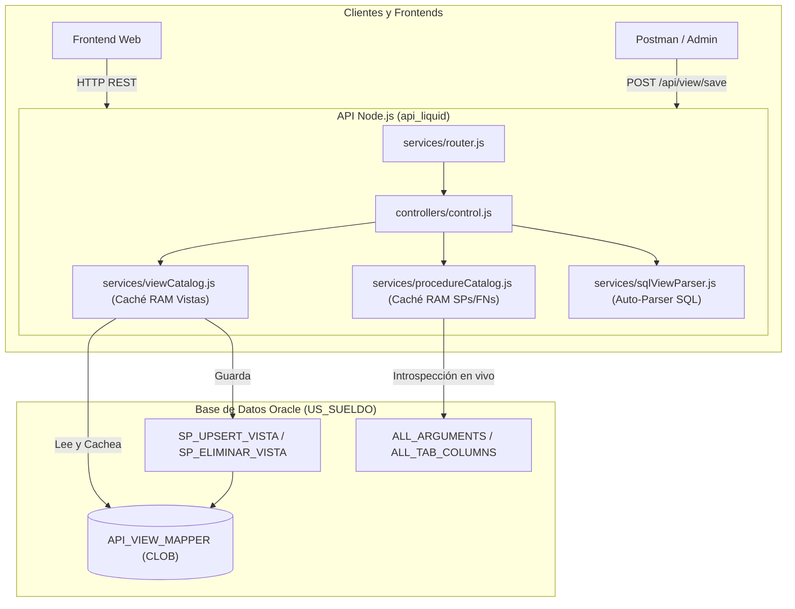

# Guía de Puesta en Funcionamiento y Arquitectura Dinámica en Oracle (Zero-Config)

Esta guía detalla el funcionamiento completo de la API tras la migración a una arquitectura **Data-Driven (Zero-Config)**. A partir de este momento, **se prescinde al 100% de la edición manual de los archivos estáticos de configuración** (`mapperViews.js`, `spmapper.js` y `fnmapper.js`).

---

## 1. Resumen de la Arquitectura



### Componentes Clave:
* **Zero Configuration en JavaScript**: Ya no se tocan `mapperViews.js`, `spmapper.js` ni `fnmapper.js`.
* **Caché en Memoria RAM**: 0 ms de overhead en lecturas; tanto las vistas como los SPs se almacenan en RAM al primer llamado.
* **Fallback Silencioso**: Si la base de datos se reinicia o sufre cortes temporales de red, los archivos locales actúan como respaldo para garantizar que ningún cliente de producción se rompa.
* **Auto-Parser SQL**: Convierte cualquier sentencia `SELECT ... FROM ...` pura en la estructura JSON requerida sin intervención manual.

---

## 2. Puesta en Funcionamiento de la API

### Paso 1: Variables de Entorno (`.env`)
Verifica que tu archivo `.env` tenga los valores correctos de conexión a Oracle:
```env
USERDB="US_SUELDO"
PASSWORD="TuPassword"
CONNECTIONSTRING="181.14.228.210:1521/desa"
HTTP_PORT=3005
HTTPS_PORT=3007
ENABLE_HTTPS=false
```

### Paso 2: Iniciar la API

#### En desarrollo (con recarga automática):
```bash
npm start
```
*(Utiliza `nodemon index.js`).*

#### En producción (modo servicio persistente en segundo plano):
Si utilizas **PM2**:
```bash
pm2 start index.js --name "api_liquid"
pm2 save
```
O de forma directa con Node:
```bash
node index.js
```

### Paso 3: Salida Esperada en Consola
```text
Starting application
Initializing database module
Oracle Client cargado desde: ./oracle-client/instantclient_23_3
Conexión a BD establecida: US_SUELDO@181.14.228.210:1521/desa
Initializing web server module
Web http server listening on http://localhost:3005/api
```

---

## 3. Armado Automático de Vistas y Consultas (Zero-JSON)

Para agregar o modificar consultas ya **no necesitas escribir JSONs complejos ni tocar archivos**. Puedes usar cualquiera de los 3 métodos automáticos:

### Método A: Enviando tu `SELECT` en texto plano (Vía API - Recomendado)
Envías un `POST /api/view/save` indicando solo el nombre de la vista y tu consulta SQL pura:

```bash
curl -X POST http://localhost:3005/api/view/save \
     -H "Content-Type: application/json" \
     -d '{
       "viewName": "empleadosPorRep",
       "sql": "SELECT p.idpers AS PersonaId, p.dni AS Documento, p.apellido || \x27, \x27 || p.nombre AS ApeNom, c.idrep AS IdRep FROM personas p INNER JOIN cargos c ON c.idpers = p.idpers WHERE c.idrep = :IdRep ORDER BY p.apellido"
     }'
```

#### ¿Qué hace el parser automáticamente?
1. Extrae los campos, funciones (`||`, `SUM`, `CASE`) y aliases (`PersonaId`, `Documento`, `ApeNom`, `IdRep`).
2. Divide el `FROM` y los `INNER JOIN` / `LEFT JOIN` en renglones limpios.
3. Detecta los parámetros del `WHERE` (`:IdRep`) y los habilita como filtros para la URL.
4. Detecta el `ORDER BY` y `GROUP BY`.
5. Ejecuta `SP_UPSERT_VISTA` en Oracle, guarda en `API_VIEW_MAPPER` y actualiza la RAM de la API inmediatamente.

---

### Método B: Desde una Vista Física de Oracle (`CREATE VIEW`)
Si creas una vista tradicional en Oracle:
```sql
CREATE OR REPLACE VIEW V_EMPLEADOS_REP AS
SELECT p.idpers AS PersonaId, p.dni AS Documento, c.idrep AS IdRep
FROM personas p
JOIN cargos c ON c.idpers = p.idpers;
```

Solo indicas a la API que la lea:
```bash
curl -X POST http://localhost:3005/api/view/save \
     -H "Content-Type: application/json" \
     -d '{
       "viewName": "empleadosRep",
       "oracleView": "V_EMPLEADOS_REP"
     }'
```
La API consulta `ALL_TAB_COLUMNS`, mapea automáticamente todas las columnas y las guarda en `API_VIEW_MAPPER`.

---

### Método C: Por Terminal para ejecutar en DBeaver (`create_view.js`)
Si estás en la consola y quieres generar el script PL/SQL listo para ejecutar en DBeaver:

```bash
node scripts/create_view.js --name empleados "SELECT p.idpers AS PersonaId, p.dni AS Documento FROM personas p WHERE p.idpers = :PersonaId"
```
Imprime en pantalla el bloque PL/SQL con las comillas simples correctamente escapadas para copiar y presionar F5 en DBeaver.

---

## 4. Funcionamiento de Stored Procedures y Funciones

### Zero Configuración para Procedimientos Nuevos:
Cuando creas y compilas un nuevo procedimiento o función en Oracle:
```sql
CREATE OR REPLACE PROCEDURE MOD_EMPLEADOS.SPI_LEGAJO(
    p_idpers       IN NUMBER,
    p_periodo      IN NUMBER,
    p_valor_salida OUT NUMBER,
    p_valor_error  OUT NUMBER
) AS ...
```

El cliente lo puede llamar inmediatamente en la API:
```bash
POST /api/sp/empleados_spiLegajo
```
1. `services/procedureCatalog.js` detecta el procedimiento.
2. Consulta `ALL_ARGUMENTS` en Oracle, aprende el orden exacto de los parámetros `IN` y `OUT` en 1 ms.
3. Lo almacena en memoria RAM para 0 ms de latencia futura.
4. Ejecuta el procedimiento con sus bind variables correspondientes.

### Garantía de Retrocompatibilidad de Nombres Legacy:
Todos los procedimientos históricos (`HojaIns`, `novHaberesDel`, `cargoIns`, etc.) y funciones (`verifConcepto`, `asociarSalario`) siguen respondiendo intactos mediante el catálogo integrado.

---

## 5. Developer & Admin Studio y Seguridad

La API integra una suite web administrativa accesible en:
👉 `http://localhost:3005/admin` (y redirección desde `http://localhost:3005/`).

### 🛡️ Seguridad y Control de Acceso
* **Clave de Acceso (`ADMIN_ACCESS_KEY`)**: Configurada en el archivo `.env`.
* **Comparación en Tiempo Constante**: Se emplea `crypto.timingSafeEqual` en [services/adminAuth.js](../services/adminAuth.js) para evitar ataques de canal lateral / timing attacks.
* **Cabecera Requerida**: Las operaciones administrativas requieren la cabecera `X-Admin-Key: <clave>` o `Authorization: Bearer <clave>`.
* **Protección de Endpoints**: Todas las rutas de modificación (`/view/save`, `/view/upsert`, `DELETE /view/:name`, `/view/refresh`) exigen autenticación válida.

### 🎛️ Capacidades del Frontend Studio:
1. **Explorador & Tester de Vistas**: Búsqueda en vivo de las 54 vistas, formulario automático para parámetros `WHERE`, visualización de datos en tabla dinámica o JSON formateado, medición de latencia y opción de desactivación lógica.
2. **SQL Studio con Auto-Parser**: Permite redactar un `SELECT ... FROM ... WHERE ...` en texto claro, previsualizar la estructura detectada y guardarla directamente en `API_VIEW_MAPPER` con recarga inmediata en RAM.
3. **Tester de Stored Procedures y Funciones**: Formulario dinámico con introspección de parámetros `IN` y ejecución de procedimientos con visualización de cursores o retornos.
4. **Recarga de Memoria RAM**: Botón directo para refrescar la caché sin necesidad de reiniciar la API.
5. **Autonomía 100% Offline**: Cero dependencias externas; funciona sin acceso a Internet en redes municipales cerradas.

---

## 6. Tabla de Endpoints Disponibles

| Endpoint | Método | Seguridad | Descripción |
| :--- | :---: | :---: | :--- |
| `/api/view/list` | `GET` | Pública | Retorna el catálogo completo de vistas activas. |
| `/api/view/:name` | `GET` | Pública | Ejecuta una vista con filtros en URL (`?Campo=valor&limit=50&offset=0`). |
| `/api/view/save` | `POST` | `X-Admin-Key` | Crea o actualiza una vista a partir de un `SELECT` o vista de Oracle. |
| `/api/view/:name` | `DELETE` | `X-Admin-Key` | Desactiva lógicamente una vista (`IS_ACTIVE = 0`). |
| `/api/view/refresh` | `POST` | `X-Admin-Key` | Limpia la caché en RAM y recarga vistas y procedimientos. |
| `/api/catalog/refresh`| `POST` | `X-Admin-Key` | Alias para recarga completa de caché. |
| `/api/admin/verify` | `POST` | `X-Admin-Key` | Verifica si la clave suministrada es válida. |
| `/api/sp/list` | `GET` | Pública | Retorna el catálogo de Stored Procedures disponibles. |
| `/api/sp/:name` | `POST` | Pública | Ejecuta un Stored Procedure (dinámico o legacy). |
| `/api/fn/list` | `GET` | Pública | Retorna el catálogo de Funciones disponibles. |
| `/api/fn/:name` | `POST` | Pública | Ejecuta una Función de base de datos. |

---

## 7. Resumen de Archivos del Proyecto

| Archivo | Rol en el sistema |
| :--- | :--- |
| [services/public/admin/index.html](../services/public/admin/index.html) | Frontend Studio SPA nativo (Offline, Dark UI, cero dependencias). |
| [services/adminAuth.js](../services/adminAuth.js) | Middleware y validación criptográfica de seguridad con `ADMIN_ACCESS_KEY`. |
| [services/viewCatalog.js](../services/viewCatalog.js) | Gestor de caché y acceso a `API_VIEW_MAPPER`. |
| [services/procedureCatalog.js](../services/procedureCatalog.js) | Introspección dinámica de SPs y FNs desde `ALL_ARGUMENTS`. |
| [services/sqlViewParser.js](../services/sqlViewParser.js) | Motor de parseo automático de sentencias SQL `SELECT`. |
| [controllers/control.js](../controllers/control.js) | Controlador principal conectado a los catálogos dinámicos. |
| [services/router.js](../services/router.js) | Definición y enrutamiento de endpoints HTTP protegidos. |
| [services/web_server.js](../services/web_server.js) | Servidor HTTP/HTTPS y servidor estático para `/admin`. |
| [scripts/create_view.js](../scripts/create_view.js) | Utilidad CLI para generar código PL/SQL a partir de un `SELECT`. |
| [scripts/oracle_api_view_mapper.sql](../scripts/oracle_api_view_mapper.sql) | DDL de la tabla y SPs de auditoría para Oracle 11g/12c+. |
| [scripts/seed_views.sql](../scripts/seed_views.sql) | Carga inicial SQL de las 54 vistas para DBeaver / SQL Developer. |
| [scripts/generate_mappers.js](../scripts/generate_mappers.js) | Generador CLI de mappers para paquetes específicos. |
